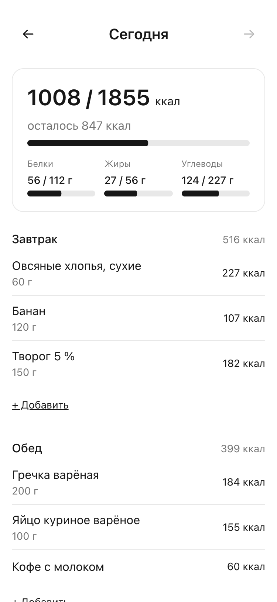
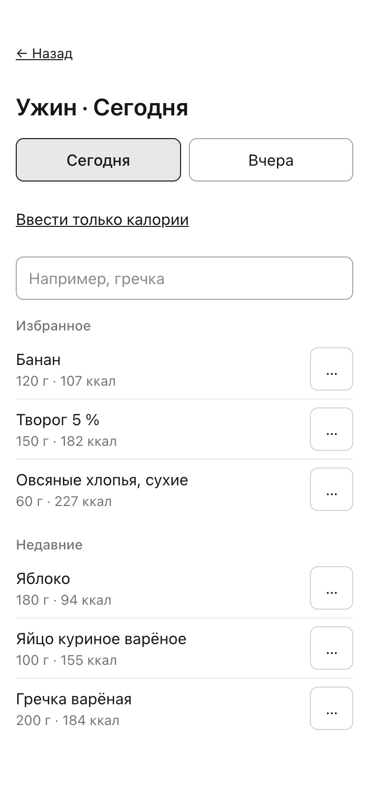
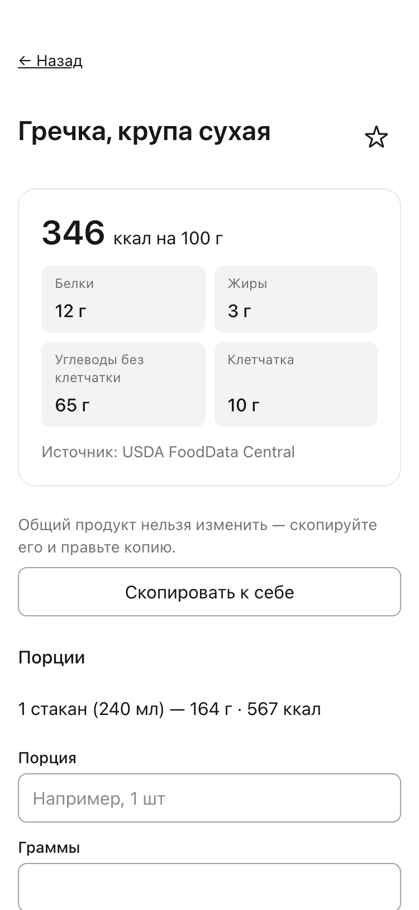
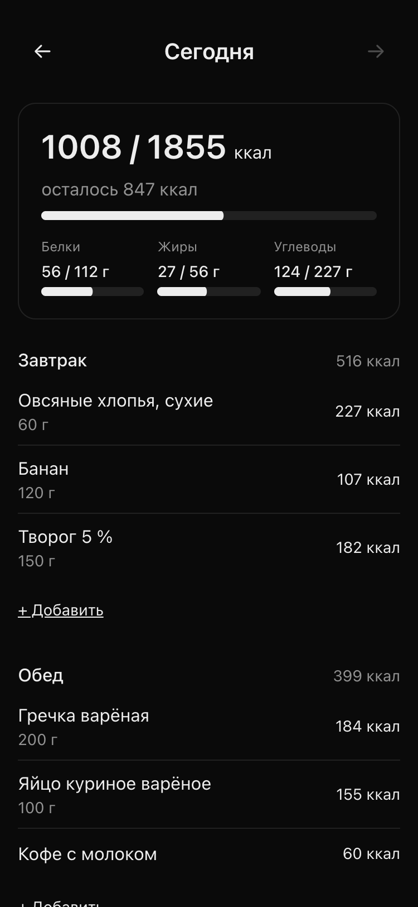

# Bitewise

[English](README.md) · **Русский**

Дневник питания на телефоне: записать приём пищи быстрее, чем за 15 секунд, и честно видеть, сколько калорий и БЖУ осталось до нормы на сегодня.

<p>
  
  
  
  
</p>

## Зачем

Большинство счётчиков калорий либо медленные (пять экранов на каждую запись), либо «умные» и неточные: цифры выдумывает нейросеть. Bitewise держится одного правила: **числа даёт база продуктов и формула, а не AI.** Все калории и БЖУ считает один модуль с тестами, продукты хранятся на 100 г, а в дневнике остаётся снимок цифр на момент записи: если продукт потом поправить, прошлые дни не изменятся. AI появится позже и будет только ускорять ввод («омлет из трёх яиц» → позиции на подтверждение), но не писать числа сам.

## Что уже умеет

- **Норма.** Профиль (пол, возраст, рост, вес, активность, цель) → норма ккал по формуле Mifflin-St Jeor и БЖУ; можно задать свою.
- **Дневник.** Завтрак, обед, ужин, перекус; продукт по граммам или порциями («1 шт = 60 г»); итоги дня и прогресс к норме; навигация по дням в часовом поясе телефона.
- **Быстрый ввод.** Избранное и недавние — в один тап, с отменой; «Повторить» прошлый завтрак; «просто 450 ккал» без продукта.
- **Продукты.** 222 базовых продукта (USDA с переводом и этикетки), поиск с первой буквы и с опечатками, свои продукты и порции, копия общего продукта к себе.
- **Свои блюда.** Борщ из восьми ингредиентов с весом готового блюда → ккал на 100 г и на порцию; в дневник добавляется как обычный продукт.
- **Приложение на телефоне.** Ставится на экран «Домой» (PWA), тёмная тема и свой акцентный цвет, без сети показывает понятный экран и сам повторяет действие, когда сеть вернётся.
- **Безопасность.** Каждый видит только свои данные; смена пароля и «Выйти на всех устройствах»; лимиты на вход и запись; логи без личных данных.

## Статус

Готовы этапы 0–5 и 6а, несколько партий полировки и безопасности; этап 6б (прод) собран без сервера. Прод-окружение (Docker Compose, nginx, TLS, бэкапы, релиз с откатом) собрано и проверено локально; сервер и домен ещё не выбраны, поэтому публичного адреса пока нет, а регистрация по умолчанию закрыта.

Дальше: сканер штрихкодов (Open Food Facts), вес и вода, затем AI-ввод текстом и по фото. Подробно — [план проекта](docs/ru/PROJECT_PLAN.md).

## Стек

Next.js 16 (App Router) · React 19 · TypeScript strict · Tailwind v4 · Postgres 17 + `pg_trgm` · Drizzle ORM · zod · Auth.js · Vitest · Docker Compose + nginx на своём VPS.

## Запуск локально

Нужны Node 24+, pnpm и Docker (или Podman) для Postgres.

```bash
pnpm install
cp .env.example .env     # заполнить NEXTAUTH_SECRET и ADMIN_PASSWORD
docker compose up -d --wait db
pnpm db:migrate && pnpm db:seed && pnpm admin:bootstrap
pnpm dev                 # http://localhost:3000, вход администратором
```

Регистрация открывается строкой `REGISTRATION=open` в `.env`. Переменные, тесты и частые проблемы — в [руководстве разработчика](docs/ru/development.md).

## Документация

|                                          |                                            |
| ---------------------------------------- | ------------------------------------------ |
| [План и статус](docs/ru/PROJECT_PLAN.md) | этапы и что уже сделано                    |
| [Функционал](docs/ru/features.md)        | что приложение умеет и что запланировано   |
| [Архитектура](docs/ru/architecture.md)   | слои, модель данных, расчёты, безопасность |
| [API](docs/ru/api.md)                    | HTTP-маршруты и server actions             |
| [Разработка](docs/ru/development.md)     | локальный запуск, тесты, миграции, CI      |
| [Деплой](docs/ru/deploy.md)              | прод на своём VPS: релиз, откат, бэкапы    |
| [Как ведём работу](docs/ru/workflow.md)  | этапы, Claude Code, ревью                  |
| [Решения](docs/ru/notes.md)              | журнал решений и открытые вопросы          |

Оглавление — [docs/ru](docs/ru/README.md); документация на английском — [docs/en](docs/en/README.md).

## Как сделано

Проект пишется с Claude Code по этапам: на каждый — спецификация и план с «ок» владельца, код по TDD, ревью субагентами (правила проекта, безопасность, интерфейс на 375 px) и только потом мерж. Правила, навыки и агенты лежат в репозитории (`CLAUDE.md`, `.claude/`), процесс описан в [workflow](docs/ru/workflow.md).

## Лицензия

Лицензия пока не выбрана: по умолчанию все права защищены.
